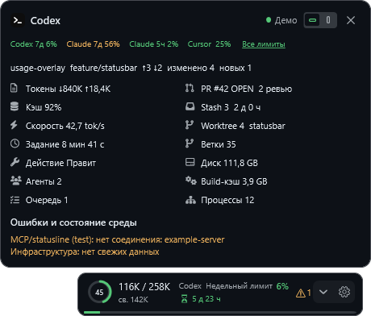
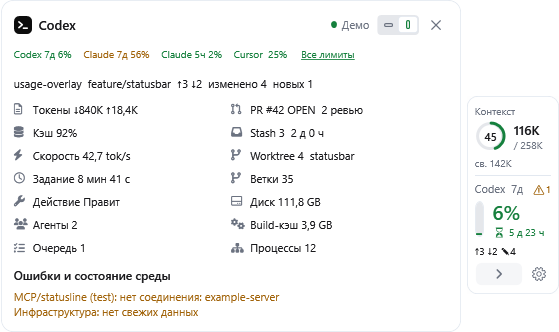

# Usage Overlay — danscMax fork

A compact Windows status bar for AI usage limits and the current workspace. This fork extends [Usage Overlay by Haroon](https://github.com/haroonsulahri/usage-overlay) with context, Git and session indicators inspired by Claude Code statusline.

**Source and updates:** [danscMax/usage-overlay](https://github.com/danscMax/usage-overlay). **Release line:** 0.5.x. Maintained independently of the original project.

По-русски: компактный виджет лимитов, контекста, Git и состояния среды. Русский и английский интерфейс, горизонтальный бар и вертикальная панель. Автор оригинала и лицензии сохранены в разделе «Благодарности».



## What this fork adds

| Area | Differences from upstream 0.4.4 |
| --- | --- |
| Layout | Compact horizontal bar or vertical dock, content-driven size, draggable position, details above/below or on the side with room. Tiny orientation switch inside details. |
| Context | Used/capacity/free tokens and an occupancy ring for the selected Codex session. Unknown readings remain `—`. |
| Git | Branch, ahead/behind, changed/untracked files, conflicts, branch count, last commit, stashes and worktrees. Optional PR/review information uses an already signed-in GitHub CLI. |
| Session | Input/output tokens, cache share, speed, task duration, action, child agents and queue when available. OS child processes are counted separately. |
| Diagnostics | Provider/Git failures and fresh existing MCP/infrastructure caches. Missing/stale sources are labelled; no new infrastructure probes. |
| Appearance | Claude statusline-style symbols and quota colours, reset countdowns, stable hover details, light/dark themes and Russian/English settings. |

Settings stays accessible on the main bar in both orientations. Hover disclosure for temporary details; click an open disclosure to close, including a card opened by hover. Click a closed disclosure to pin. `Escape` closes details. After a manual close, hover stays suppressed until the pointer leaves.



## Install or upgrade

1. Open [this fork's Releases](https://github.com/danscMax/usage-overlay/releases). An empty page means no stable release has been published yet.
2. Download `usage-overlay-vX.Y.Z-win-x64-setup.exe` or `usage-overlay-vX.Y.Z-win-x64.zip` and compare SHA-256 with `SHA256SUMS.txt`.
3. Close the existing overlay. Run Setup, or extract the complete ZIP into a writable directory and run `UsageOverlay.exe`.
4. Open the main-bar gear to choose language, layout, thresholds and integrations. Language changes require a restart.

Windows 10/11 x64 is required. Release packages bundle .NET. Binaries are currently unsigned. Settings are shared with upstream at `%USERPROFILE%\.usage-overlay\settings.json`; explicit opt-ins/opt-outs are preserved. This fork keeps the original install identity and single-instance coordination: **replace the original rather than running both together**. Back up settings before switching versions.

The ZIP includes optional Start-menu/Startup shortcut helpers. No service is installed. Portable files may be removed after the app exits; settings remain separate.

## Data sources and limits

- **Codex quotas:** a local Codex CLI/App Server signed in with ChatGPT-backed authentication. API-key-only accounts do not expose plan limits. The overlay starts its own App Server and releases it on exit.
- **Context/session:** local Codex active-thread IPC, read-only state/queue SQLite databases and incremental session rollouts. Internal formats may change. Unidentified active threads produce unknown values. Cumulative input tokens can exceed context capacity: they measure different things.
- **Claude:** optional upstream Claude Code statusline/saved-sign-in integration. It chains an existing statusline. Saved-sign-in access and automatic renewal are separate opt-ins; private endpoints may change. Claude desktop and Claude Code sign-ins may differ.
- **Cursor:** optional upstream team Admin API key or saved editor sign-in integration, configured in Settings.
- **Workspace:** Git on `PATH`; ahead/behind use local remote-tracking refs without `git fetch`. Ambiguous multi-repository selections are labelled. PR/review counts require an existing `gh` sign-in and are cached. Resources and diagnostics depend on available local files/caches.

Extended context/session/workspace indicators currently target Codex. Other providers supply usage limits; equivalent session telemetry for all providers is not promised. Quota colours use configured warning/critical thresholds (50%/80% used by default). Quota, time until reset and context occupancy are separate readings.

## Privacy and updates

Manual **Check for updates** requests the latest stable release from `danscMax/usage-overlay` only. It opens the release page; it does not automatically download or replace the app. No first published release is a normal state.

Workspace/session data stays local. Optional installation reporting remains **off by default**. If enabled, the inherited integration sends a random installation ID and app version to the original Haroone endpoint; this fork adds no new collector. See [privacy and data sources](docs/privacy.md). Review logs/screenshots before sharing them.

## Build and verify

Use a .NET 8 SDK compatible with `global.json`, PowerShell 7 and Inno Setup 6.7.1 for the installer. From the checkout:

```powershell
.\scripts\build.ps1
.\scripts\package-release.ps1 -Version 0.5.0
.\scripts\validate-release.ps1 -Version 0.5.0
```

The build runs core and integration specs. Native UI fixture checks cover both themes:

```powershell
.\tests\UsageOverlay.AccountSwitch.Specs\bin\Release\net8.0-windows\UsageOverlay.AccountSwitch.Specs.exe --render-presentation artifacts\presentation
```

Packaging creates a self-contained ZIP, per-user installer, checksums and manifest under `artifacts/release`. Release branches build and validate packages before tagging. Tag workflows create a **draft** release for review. Pushing a tag and publishing the draft are separate maintainer actions. See [release notes](RELEASE_NOTES.md), [changelog](CHANGELOG.md), [support](SUPPORT.md) and [security](SECURITY.md).

## Acknowledgements and licenses

- **Haroon / Haroone.com:** original [Usage Overlay](https://github.com/haroonsulahri/usage-overlay), MIT. Original copyright and full [LICENSE](LICENSE) retained unchanged.
- **CodexStatusbar contributors:** adapted [session/IPC readers](https://github.com/dongyue-19/codex-statusbar), MIT.
- **Microsoft / Saja Typeworks, Nerd Fonts contributors, Fonticons and GitHub:** CaskaydiaCove font subset and component icons, under their separate licenses.
- **danscMax:** fork maintenance/additions, also MIT. Settings credits are under **Acknowledgements / Благодарности**.

See [third-party notices](THIRD-PARTY-NOTICES.md) and the `licenses` directory in both release packages. Provider names/logos belong to their owners. This is an independent community utility.
